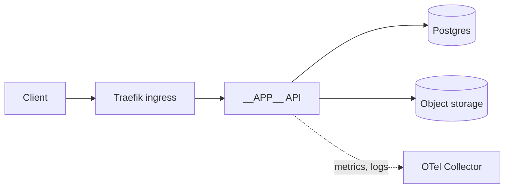

# __APP__ architecture

## Context

What problem this solves and what it deliberately does not do.

## Components

## Data

What is stored, where, how long, and who may read it.

## Failure modes

| Failure | Behaviour | Mitigation |
|---|---|---|
| Database down | `/readyz` fails; requests return 503 | retry with backoff; alert |

## Decisions

See [adr/](adr/).
