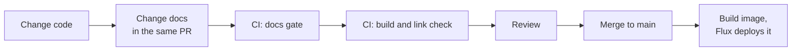

Docs go stale for one reason: **nothing breaks when they do.** So we make something break.

Each box is a place a stale page can be caught. Start with the [overview](/start/overview/) and then try the [rollback guide](/how-to/roll-back-a-deploy/).
